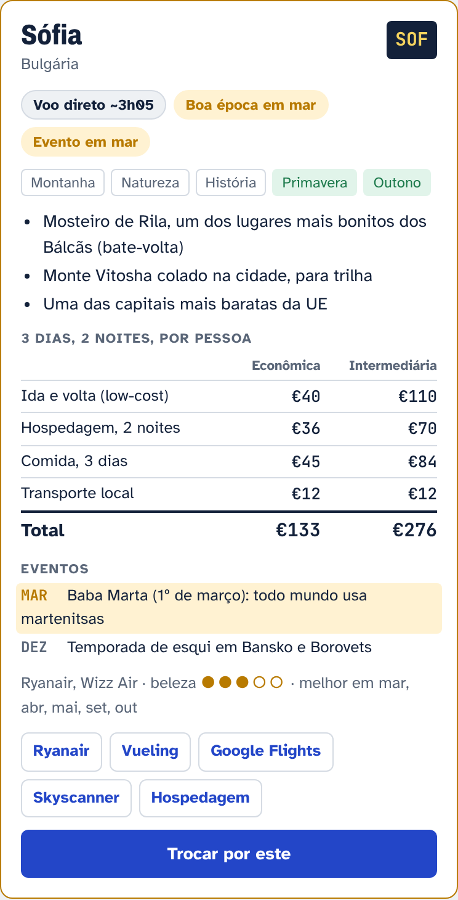
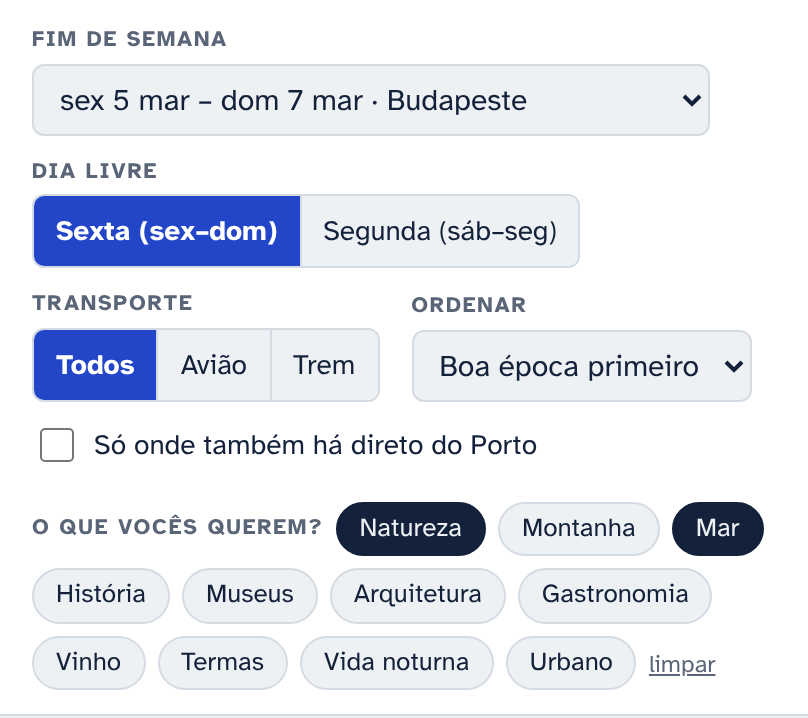
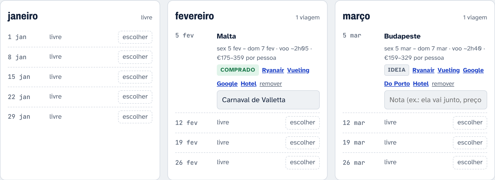

# Novidades do Escapadas 2027

## 25 de outubro de 2026

### 💶 Quanto custa a viagem, item por item

O antigo "custo por dia" virou o custo da viagem inteira: 3 dias e 2 noites, por pessoa. Ele aparece separado em passagem, hospedagem, comida e transporte local, em duas faixas:

- **Econômica**: passagem em promoção, quarto privado em hostel ou apartamento simples, comida de mercado e de rua
- **Intermediária**: tarifa low-cost normal sem mala despachada, hotel 3 estrelas, uma refeição em restaurante por dia

### 🏷️ Por que ir: tags, destaques e eventos

Cada destino ganhou:

- **Tags de interesse**: natureza, montanha, mar, história, museus, arquitetura, gastronomia, vinho, termas, vida noturna, urbano
- **Tags de estação**: inverno, primavera, verão, outono
- **Três destaques** que explicam por que vale a viagem
- **Eventos do ano**, como o Carnaval de Veneza, a Fête des Lumières em Lyon, o São João no Porto e os mercados de Natal. Quando o evento cai no mês escolhido, ele aparece destacado

### 🔎 O que vocês querem?

Um filtro novo por interesse. Dá para marcar mais de um, por exemplo **Natureza** e **Mar**, e ver só os destinos que têm os dois.

### ✈️ Ryanair e Vueling

Os cards agora têm botões para a **Ryanair**, que já abre com as datas do fim de semana, e para a **Vueling**. Google Flights, Skyscanner e Booking continuam lá. Belgrado saiu da lista porque o voo direto de Barcelona não é low-cost.

### 📱 Filtros mais leves no celular

No celular, a barra de filtros não fica mais presa no topo da tela, então sobra espaço para ver os destinos.

### 🗓️ Lançamento

O primeiro Escapadas: todos os fins de semana de 2027 com sexta ou segunda livre, destinos com voo ou trem direto de Barcelona e a aba **Meu ano** para montar o plano, marcando cada viagem como *Ideia* ou *Comprado*.

